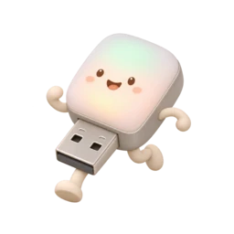

# nb1 mascot and favicon

Use this approved mascot consistently in the workbench, documentation and project websites. The transparent master is [`brand/nb1-mascot.png`](../brand/nb1-mascot.png). Its SHA-256 is `d831c14b7ad268c82dcd72bd93ede237e35a290b330fd9152d9ee96b802d3295`.

| Asset | Use |
| --- | --- |
| `brand/nb1-mascot.png` | Unmodified full-resolution transparent master, 1316 × 1195. |
| `src/assets/nb1-mascot.webp` | 256 × 256 transparent production illustration for headers and documentation. |
| `src/assets/nb1-icon.png` | 64 × 64 transparent favicon made from the same artwork. |

Both production files scale the complete master proportionally and center it on a transparent square. The character is not cropped, redrawn, recolored or stretched. The PNG favicon keeps the same character as the illustration. There is no separate simplified mascot.

All runtime assets are bundled locally. The master stays in the source repository and is not shipped in the embedded Web bundle. The independent documentation site uses byte-identical copies of the production files. When updating the asset, update the workbench, favicon and documentation together, then rebuild the pinned nb1 bundle.

The mascot is decorative. Device connection, cached channel values and errors remain in labeled controls and text. It is a project illustration, not an official ThingM or Nintendo asset. It uses no game characters, logos or textures. The repository license applies to these project assets.

Only the approved artwork and necessary production derivatives belong in the repository. Selection galleries, alternate candidates, prompts and generation records remain in local development storage.
